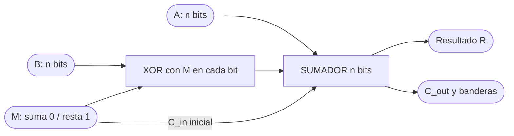

# SUMADOR Y RESTADOR CON EL MISMO CIRCUITO

> [!seealso]- MIRA TAMBIÉN
> - [Sumador completo](full_adder.md)
> - [Complemento a dos](../representation/twos_complement.md)
> - [Cambio de signo](../representation/twos_complement_negation.md)
> - [ALU](alu.md)

> [!important] CONCEPTOS IMPORTANTES
> - La resta se transforma en **suma del complemento a dos**: $A-B=A+\overline B+1$.
> - Un bit de control $M$ puede decidir entre sumar (`0`) y restar (`1`).
> - Para hacer la resta correctamente hay que **invertir todos los bits de B y sumar 1**; invertir B sin añadir 1 daría otro resultado.
> - Las banderas de **acarreo**, **cero**, **signo** y **desbordamiento** permiten interpretar resultados.
## DEFINICIÓN

No es necesario fabricar un circuito totalmente distinto para restar números binarios. Si ya tenemos un **sumador de $n$ bits**, podemos reutilizarlo aprovechando el [complemento a dos](../representation/twos_complement.md).

> [!abstract] IDENTIDAD FUNDAMENTAL
> $$A-B=A+(\overline B+1)$$
>
> Las operaciones de ancho fijo se realizan módulo $2^n$.

## CONTROL DE SUMA O RESTA

Añadimos una señal de control $M$:

- `M=0`: sumar $A+B$.
- `M=1`: restar $A-B$.

Cada bit de B pasa por una puerta XOR con $M$. La entrada inicial de acarreo del sumador también recibe $M$.

> [!abstract] FÓRMULA DEL CIRCUITO
> $$R=A+(B\oplus\underbrace{MM\ldots M}_{n\text{ bits}})+M\pmod{2^n}$$
>
> Equivalentemente, para cada posición $i$: $B'_i=B_i\oplus M$ y $C_0=M$.

| M | $B_i\oplus M$ | $C_0$ | Operación |
| :-: | --- | :-: | --- |
| 0 | $B_i$ | 0 | $A+B$ |
| 1 | $\overline{B_i}$ | 1 | $A-B$ |



## EJEMPLO DE SUMA

> [!example] EJEMPLO — `5 + 3` CON 8 BITS
> `M=0` deja B intacto y fija el acarreo inicial a 0.
>
> ```text
>    A: 0000 0101  (5)
>    B: 0000 0011  (3)
>       ---------
>    R: 0000 1000  (8)
> ```

## EJEMPLO DE RESTA

> [!example] EJEMPLO — `5 - 3` CON 8 BITS
> `M=1`: invertir todos los bits de B y poner `C_in=1`.
>
> ```text
>    A:       0000 0101   (+5)
>    B:       0000 0011   (+3)
>    NOT B:   1111 1100
>    C_in:            1
>    -------------------
>    Suma:  1 0000 0010
>    R:       0000 0010   (+2)
> ```
>
> El `1` extra de la izquierda es el **acarreo de salida**, que no pertenece al resultado de 8 bits.

> [!example] EJEMPLO — `2 - 5` CON 8 BITS
> ```text
>    A:       0000 0010
>    B:       0000 0101
>    NOT B:   1111 1010
>    C_in:            1
>    -------------------
>    R:       1111 1101  (-3 en complemento a dos)
> ```
>
> En este caso no hay acarreo exterior (`C_out=0`): para una resta **sin signo** indica préstamo. Como operación **con signo**, el resultado -3 es válido y no hay desbordamiento.

## BANDERAS DEL RESULTADO

Las ALU suelen calcular varias banderas, en lugar de limitarse a devolver el patrón resultante:

| Bandera | Significado |
| --- | --- |
| `Z` (*zero*) | 1 si todos los bits del resultado son 0 |
| `N` (*negative*) | Copia del MSB del resultado |
| `C` (*carry*) | Acarreo de salida del bit más significativo |
| `V` (*overflow*) | Desbordamiento aritmético **con signo** |

### DESBORDAMIENTO CON SIGNO

En una **suma**, hay desbordamiento cuando los operandos tienen el mismo signo y el resultado tiene un signo diferente.

En una **resta**, hay desbordamiento cuando $A$ y $B$ tienen signos diferentes y el resultado tiene signo distinto del de $A$.

Otra forma de calcularlo en suma/resta de complemento a dos es:

> [!abstract] DESBORDAMIENTO
> $$V=C_{n-1}\oplus C_n$$
>
> $C_{n-1}$ es el acarreo que **entra** al bit de signo y $C_n$ el que **sale** de él.

> [!warning] NO CONFUNDIR ACARREO Y DESBORDAMIENTO
> `C=1` no implica necesariamente `V=1`. Por ejemplo, `5-3` produce acarreo exterior 1 y **no** desbordamiento con signo. En una resta sin signo implementada así, `C=1` significa **ausencia de préstamo**.

## RESTAR Y NEGAR

El mismo circuito puede obtener `-B`: basta fijar $A=0$, elegir `M=1` y calcular $0-B$. La limitación del mínimo negativo sigue vigente.

## EJERCICIOS

1. Representa el circuito para `7-2` con 4 bits.
2. Calcula `-3-5` con 8 bits, indicando el resultado.
3. Explica por qué `0111 + 0011` produce desbordamiento con signo si son números de 4 bits.
4. En una resta sin signo con `C_out=0`, ¿qué significa esa bandera?

> [!external-link]- REFERENCIAS WEB
> - [Circuitos de suma/resta y acarreo propagado (Sonoma State University)](https://bob.cs.sonoma.edu/IntroCompOrg-x64/bookch5.html)
