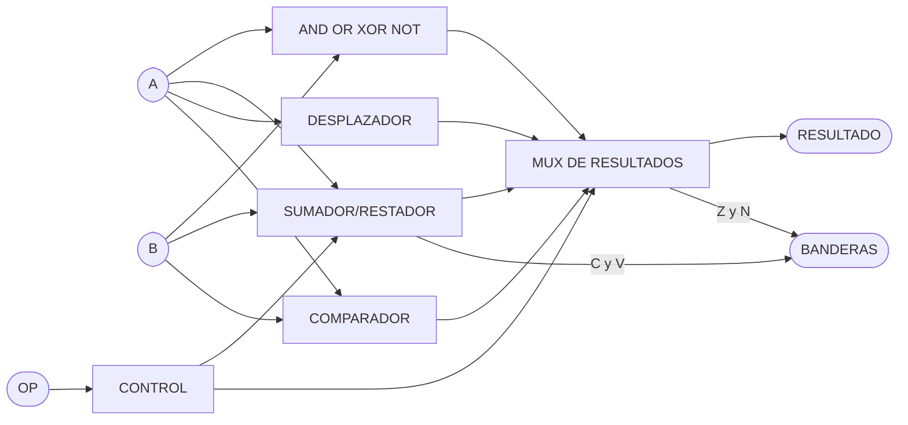

# UNIDAD ARITMÉTICO-LÓGICA (ALU)

> [!seealso]- MIRA TAMBIÉN
> - [Sumador/restador](adder_subtractor.md)
> - [Multiplexadores](../components/multiplexers_demultiplexers.md)
> - [Circuitos secuenciales](../components/sequential_logic.md)

> [!important] CONCEPTOS IMPORTANTES
> - La **ALU** recibe operandos y una operación seleccionada por señales de control.
> - Puede reutilizar el mismo sumador para suma, resta y algunas comparaciones.
> - Un multiplexador elige qué salida interna entrega la ALU.
> - Las banderas de estado ayudan a interpretar resultados y ejecutar decisiones.
## DEFINICIÓN

Una **unidad aritmético-lógica**, o **ALU** (*Arithmetic Logic Unit*), es un componente que ejecuta operaciones sobre palabras binarias, como suma, resta, AND, OR, XOR y comparaciones.

No todas las ALU contienen obligatoriamente multiplicador o divisor: estos pueden ser unidades separadas, compartir recursos o ejecutarse mediante instrucciones y ciclos adicionales.

## EJEMPLO DE ALU SIMPLE DE 8 BITS

Imaginemos una ALU con dos entradas `A`, `B` de 8 bits y un selector `OP` de 3 bits.

| OP | Operación | Salida |
| :-: | --- | --- |
| `000` | AND | $A\land B$ |
| `001` | OR | $A\lor B$ |
| `010` | XOR | $A\oplus B$ |
| `011` | Suma | $A+B$ |
| `100` | Resta | $A-B$ |
| `101` | NOT A | $\overline A$ |
| `110` | Desplazar A una posición a la izquierda | $A\ll1$ |
| `111` | Igualdad | `00000001` si $A=B$; en otro caso `00000000` |

Esta tabla es **un diseño didáctico**: las codificaciones reales dependen de la CPU o del circuito elegido.

## ARQUITECTURA POR BLOQUES

Los bloques calculan posibles resultados y un **multiplexador** selecciona el que corresponde al código `OP`.

## REUTILIZACIÓN DEL SUMADOR

La ALU puede usar el circuito descrito en [Sumador/restador](adder_subtractor.md):

$$R=A+(B\oplus M)+M\pmod{2^n}$$

Aquí $B\oplus M$ significa **XOR bit a bit con una máscara formada por $n$ copias de $M$**. Según `M` el mismo circuito suma o resta. La lógica de comparación puede reutilizar su resultado y sus banderas.

## BANDERAS

Un conjunto habitual (pero no universal) de banderas es:

- **Z:** el resultado es cero.
- **N:** valor del bit más significativo del resultado.
- **C:** acarreo de salida (o ausencia de préstamo en resta sin signo, según convención).
- **V:** desbordamiento aritmético **con signo**.

> [!example] EJEMPLO — COMPARAR DOS VALORES
> Una comparación $A<B$ con signo puede realizarse restando $A-B$, sin guardar necesariamente ese resultado como dato final. Si `N XOR V = 1`, entonces $A<B$ (interpretando ambos operandos con signo y el restador configurado correctamente).

## RELACIÓN CON LOS REGISTROS

Los registros suministran operandos estables y capturan resultados en instantes controlados por reloj. Una ALU combinacional aislada **no guarda** el resultado por sí misma; la memoria del sistema la proporcionan elementos secuenciales.

## CONSTRUIR UNA ALU DESDE CERO

1. Diseñar las [puertas lógicas](../logic/logic_gates.md).
2. Construir un [sumador completo](full_adder.md) de un bit.
3. Encadenarlo hasta obtener un sumador de $n$ bits.
4. Añadir las XOR de control para [suma/resta](adder_subtractor.md).
5. Implementar AND, OR, XOR, NOT y desplazamientos de palabra.
6. Elegir una salida con un [MUX](../components/multiplexers_demultiplexers.md).
7. Calcular y comprobar banderas.

## EJERCICIOS

1. ¿Qué componente puede seleccionar entre el resultado de AND y el de suma?
2. ¿Por qué no hacen falta dos sumadores distintos para `A+B` y `A-B`?
3. ¿Puede una ALU combinacional almacenar un resultado sin registros externos?
