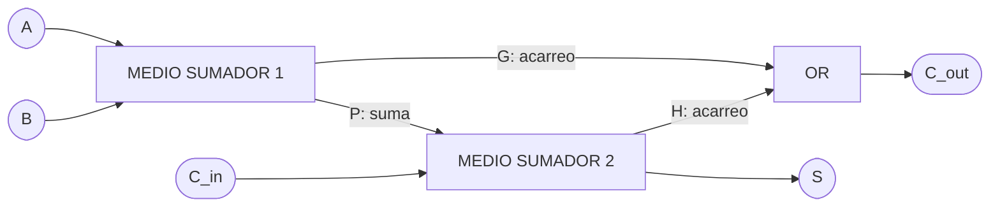

# SUMADOR COMPLETO

> [!seealso]- MIRA TAMBIÉN
> - [Medio sumador](half_adder.md)
> - [Sumador/restador](adder_subtractor.md)
> - [Complemento a dos](../representation/twos_complement.md)

> [!important] CONCEPTOS IMPORTANTES
> - Un **sumador completo** suma tres bits: $A$, $B$ y $C_{in}$.
> - Produce un bit de suma y un acarreo hacia la siguiente columna.
> - Encadenando sumadores completos se construye un sumador de $n$ bits (*ripple-carry*).
## DEFINICIÓN

Un **sumador completo** (*full adder*) añade a los dos bits de entrada un tercero: el **acarreo de entrada** $C_{in}$, que puede venir de una posición menos significativa.

```text
            ┌─────────────────┐
A ─────────►│                 ├──► S
B ─────────►│ SUMADOR COMPLETO├──► C_out
C_in ──────►│                 │
            └─────────────────┘
```

## TABLA DE VERDAD

| A | B | $C_{in}$ | S | $C_{out}$ |
| :-: | :-: | :-: | :-: | :-: |
| 0 | 0 | 0 | 0 | 0 |
| 0 | 0 | 1 | 1 | 0 |
| 0 | 1 | 0 | 1 | 0 |
| 0 | 1 | 1 | 0 | 1 |
| 1 | 0 | 0 | 1 | 0 |
| 1 | 0 | 1 | 0 | 1 |
| 1 | 1 | 0 | 0 | 1 |
| 1 | 1 | 1 | 1 | 1 |

> [!abstract] FÓRMULAS
> $$S=A\oplus B\oplus C_{in}$$
> $$C_{out}=(A\land B)\lor((A\oplus B)\land C_{in})$$

Otra expresión equivalente es: $C_{out}=AB+AC_{in}+BC_{in}$ (función de **mayoría**: el acarreo vale 1 si al menos dos entradas son 1).

## CONSTRUIRLO CON DOS MEDIOS SUMADORES

1. Primer medio sumador: $P=A\oplus B$ y $G=A\land B$.
2. Segundo medio sumador: $S=P\oplus C_{in}$ y $H=P\land C_{in}$.
3. Combinar acarreos: $C_{out}=G\lor H$.



## SUMADOR DE VARIOS BITS

Para sumar dos números de $n$ bits encadenamos $n$ sumadores completos, empezando por el bit 0 (LSB). El acarreo de cada etapa alimenta la siguiente:

```text
             A0 B0       A1 B1       A2 B2       A3 B3
               │           │           │           │
C0=0 ───► [FA0] ──C1──► [FA1] ──C2──► [FA2] ──C3──► [FA3] ──► C4
              │S0         │S1         │S2         │S3

              Resultado de 4 bits: S3 S2 S1 S0
```

Esto es un **sumador de acarreo propagado** (*ripple-carry adder*). Es simple, aunque las etapas altas pueden tener que esperar a los acarreos anteriores.

> [!example] EJEMPLO — $0111_2 + 0011_2$
> ```text
>    0111 (7)
>  + 0011 (3)
>  ------
>    1010 (10 como entero sin signo de 4 bits)
> ```
>
> El patrón `1010` representa **-6** si se interpreta como complemento a dos de 4 bits; en ese caso la suma de +7 y +3 ha **desbordado con signo**.

## SUMADORES MÁS RÁPIDOS

Existen otras arquitecturas, como **carry-lookahead**, que calculan información de generación y propagación de acarreos para reducir la espera, a costa de mayor complejidad. Son una continuación natural tras comprender el *ripple-carry*.

## EJERCICIOS

1. Calcula $S$ y $C_{out}$ cuando `A=B=C_in=1`.
2. ¿Cuántos sumadores completos hacen falta para un sumador *ripple-carry* de 8 bits?
3. ¿Por qué el sumador completo necesita `C_in`?
