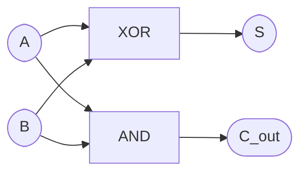

# MEDIO SUMADOR

> [!seealso]- MIRA TAMBIÉN
> - [Puertas lógicas](../logic/logic_gates.md)
> - [Sumador completo](full_adder.md)

> [!important] CONCEPTOS IMPORTANTES
> - Un **medio sumador** suma dos bits, sin acarreo de entrada.
> - La salida de suma se calcula con **XOR** y el acarreo con **AND**.
> - Es el bloque más sencillo para entender un sumador completo.
## DEFINICIÓN

Un **medio sumador** (*half adder*) es un circuito combinacional que suma dos bits individuales, $A$ y $B$. Produce una salida de suma $S$ y un acarreo de salida $C_{out}$.

```text
        ┌──────────────┐
A ─────►│              ├──► S
B ─────►│ MEDIO SUMADOR├──► C_out
        └──────────────┘
```

## TABLA DE VERDAD

| A | B | S | $C_{out}$ |
| :-: | :-: | :-: | :-: |
| 0 | 0 | 0 | 0 |
| 0 | 1 | 1 | 0 |
| 1 | 0 | 1 | 0 |
| 1 | 1 | 0 | 1 |

La fila `1+1` genera el número binario `10`: el bit bajo es 0 y el acarreo es 1.

> [!abstract] FÓRMULAS
> $$S=A\oplus B$$
> $$C_{out}=A\land B$$

## CONSTRUCCIÓN CON PUERTAS

Una puerta XOR calcula el bit de suma y una AND calcula el acarreo; ambas reciben las mismas entradas.



## LIMITACIÓN

Un medio sumador **no tiene entrada de acarreo**. Por tanto, resulta insuficiente para sumar columnas intermedias de dos números de varios bits, donde puede llegar un acarreo desde la columna de la derecha. Para eso se necesita el [sumador completo](full_adder.md).

## EJEMPLO

> [!example] EJEMPLO — $1+1$
> ```text
> A = 1
> B = 1
> S = 0
> C_out = 1
> Resultado = 10₂ = 2₁₀
> ```

## EJERCICIOS

1. ¿Qué salidas produce si `A=0`, `B=1`?
2. ¿Por qué una puerta OR no puede sustituir a la XOR en la salida de suma?
