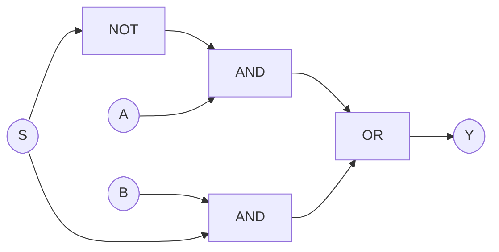

# MULTIPLEXADORES Y DEMULTIPLEXADORES

> [!seealso]- MIRA TAMBIÉN
> - [Puertas lógicas](../logic/logic_gates.md)
> - [Codificadores y decodificadores](encoders_decoders.md)
> - [ALU](../arithmetic/alu.md)

> [!important] CONCEPTOS IMPORTANTES
> - Un **MUX** selecciona una de varias entradas y la conecta a una salida.
> - Un **DEMUX** dirige una entrada hacia una de varias salidas.
> - Con $k$ bits de selección pueden elegirse hasta $2^k$ alternativas.
## MULTIPLEXADOR (MUX)

Un **multiplexador** permite seleccionar qué señal o palabra llega a una salida. Un MUX 2:1 tiene entradas `A`, `B`, un selector `S` y salida `Y`:

```text
      ┌────────┐
A ───►│        │
B ───►│  MUX   ├──► Y
S ───►│  2:1   │
      └────────┘
```

| S | Y |
| :-: | --- |
| 0 | A |
| 1 | B |

> [!abstract] EXPRESIÓN BOOLEANA
> $$Y=(\overline S\land A)\lor(S\land B)$$

### CONSTRUIR UN MUX CON PUERTAS

1. Invertir $S$ mediante NOT.
2. Calcular $A\land\overline S$ con AND.
3. Calcular $B\land S$ con otra AND.
4. Unir los resultados usando OR.



También puede implementarse **solo con NAND**, según [Construcciones con NAND](../logic/nand_composition.md).

### MUX 4:1

Con cuatro entradas `D0..D3` hacen falta **dos bits de selección** `S1 S0`.

| S1 | S0 | Y |
| :-: | :-: | --- |
| 0 | 0 | D0 |
| 0 | 1 | D1 |
| 1 | 0 | D2 |
| 1 | 1 | D3 |

Podemos construirlo conectando **tres MUX 2:1**: dos seleccionan entre `D0/D1` y `D2/D3` mediante `S0`; el tercero escoge una de esas salidas mediante `S1`.

## DEMULTIPLEXADOR (DEMUX)

Un **demultiplexador** recibe una señal `D` y, según `S`, la envía a una de varias salidas. En un DEMUX 1:2:

```text
        ┌─────────┐
D ─────►│         ├──► Y0
S ─────►│ DEMUX   ├──► Y1
        └─────────┘
```

> [!abstract] ECUACIONES
> $$Y_0=D\land\overline S$$
> $$Y_1=D\land S$$

| D | S | Y0 | Y1 |
| :-: | :-: | :-: | :-: |
| 0 | 0 | 0 | 0 |
| 0 | 1 | 0 | 0 |
| 1 | 0 | 1 | 0 |
| 1 | 1 | 0 | 1 |

> [!note] NOTA
> Un DEMUX de señales lógicas no crea copias de información ni guarda datos por sí mismo: simplemente condiciona qué salida está activa. Puede ser útil distinguirlo de un [decodificador](encoders_decoders.md), aunque sus expresiones son parecidas.

## ENTRADAS DE VARIOS BITS

Un MUX puede seleccionar palabras completas: por ejemplo, elegir entre dos buses de 8 bits. Internamente puede verse como **ocho MUX 2:1 en paralelo**, que comparten el selector. No se deben confundir **número de entradas seleccionables** y **ancho de cada entrada**.

## APLICACIONES

- Elegir uno de varios resultados de una [ALU](../arithmetic/alu.md).
- Seleccionar una dirección, dato o fuente de control.
- Dirigir una señal hacia uno de varios destinos.

## EJERCICIOS

1. ¿Cuántas líneas de selección necesita un MUX 8:1?
2. ¿Qué sale de un MUX 2:1 si `A=1`, `B=0` y `S=1`?
3. Escribe la ecuación de `Y2` de un DEMUX 1:4 con selectores `S1 S0`.
