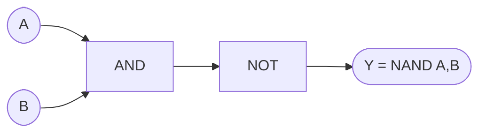

# PUERTAS LÓGICAS

> [!seealso]- MIRA TAMBIÉN
> - [Álgebra de Boole](boolean_algebra.md)
> - [NAND en CMOS](cmos_nand.md)
> - [Crear otras puertas con NAND](nand_composition.md)

> [!important] CONCEPTOS IMPORTANTES
> - Una puerta lógica transforma una o más entradas binarias en una salida.
> - NOT, AND, OR, XOR, NAND, NOR y XNOR son funciones lógicas habituales.
> - La **tabla de verdad** describe la función, independientemente de su implementación electrónica.
## DEFINICIÓN

Una **puerta lógica** es un componente que implementa una función booleana. En electrónica digital, las entradas y salidas se representan con intervalos de tensión reconocidos como niveles lógicos `0` o `1`.

## PUERTAS BÁSICAS

### NOT

Invierte un bit: $Y=\overline A$.

| A | Y |
| :-: | :-: |
| 0 | 1 |
| 1 | 0 |

### AND

Da `1` solamente si **ambas** entradas son `1`: $Y=A\land B$.

### OR

Da `1` si **al menos una** entrada es `1`: $Y=A\lor B$.

### XOR

Da `1` si las entradas son **diferentes**: $Y=A\oplus B$.

### NAND

Es la negación de AND: $Y=\overline{A\land B}$.

### NOR

Es la negación de OR: $Y=\overline{A\lor B}$.

### XNOR

Es la negación de XOR: $Y=\overline{A\oplus B}$; vale `1` cuando las entradas son **iguales**.

## TABLA DE VERDAD COMPLETA

| A | B | AND | OR | XOR | NAND | NOR | XNOR |
| :-: | :-: | :-: | :-: | :-: | :-: | :-: | :-: | :-: |
| 0 | 0 | 0 | 0 | 0 | 1 | 1 | 1 |
| 0 | 1 | 0 | 1 | 1 | 1 | 0 | 0 |
| 1 | 0 | 0 | 1 | 1 | 1 | 0 | 0 |
| 1 | 1 | 1 | 1 | 0 | 0 | 0 | 1 |

## CÓMO SE CONECTAN LAS PUERTAS

Las salidas de unas puertas pueden alimentar entradas de otras, formando un **circuito combinacional**: la salida depende solamente de las entradas actuales (tras el tiempo de propagación del circuito).

Un circuito con memoria, por el contrario, puede depender de estados anteriores. Se explica en [Circuitos secuenciales](../components/sequential_logic.md).

## PUERTAS UNIVERSALES

Las puertas **NAND** y **NOR** se llaman **funcionalmente completas**: combinando únicamente puertas de uno de esos tipos podemos implementar todas las funciones booleanas.

> [!example] EJEMPLO — NOT UTILIZANDO NAND
> $$\operatorname{NAND}(A,A)=\overline{A\land A}=\overline A$$

## LIMITACIONES DE LOS CIRCUITOS REALES

Una tabla de verdad supone niveles `0/1` ideales. En un circuito físico también importan el tiempo de propagación, la corriente consumida, el fan-out (carga de salida), el ruido y las transiciones entre niveles.

## EJERCICIOS

1. Escribe la fila de la tabla de verdad cuando $A=1$ y $B=0$.
2. ¿Qué puerta sirve para detectar que dos bits son diferentes?
3. ¿Qué puerta da `1` solamente cuando sus dos entradas son `0`?
