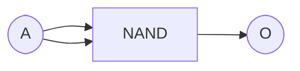
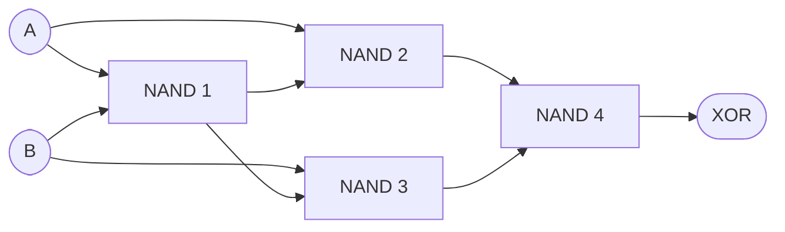

# CONSTRUIR PUERTAS A PARTIR DE NAND

> [!seealso]- MIRA TAMBIÉN
> - [Álgebra de Boole](boolean_algebra.md)
> - [NAND con transistores](cmos_nand.md)
> - [Multiplexadores](../components/multiplexers_demultiplexers.md)

> [!important] CONCEPTOS IMPORTANTES
> - NAND es una **puerta universal**: basta para construir todas las funciones booleanas.
> - Una NOT puede implementarse conectando ambas entradas de una NAND a la misma señal.
> - También es posible construir multiplexadores, sumadores y una ALU utilizando NAND como bloque lógico de base.

## DEFINICIÓN

Decir que una puerta es **universal** significa que podemos construir cualquier función booleana combinando suficientes copias. NAND resulta especialmente interesante porque su implementación CMOS básica es sencilla.

Escribiremos $N (A, B) = \overline{A \land B}$ para abreviar.

## NOT CON UNA NAND

%%

```text
     ┌─╦══════╗
(A)──┤ ║ NAND ╠──(NOT A)
     └─╩══════╝
```

%%



## AND CON DOS NAND

> [!abstract] FÓRMULA
> 
> $$A \land B = N(N(A, B), N(A, B))$$

La primera NAND obtiene $\overline{AB}$; la segunda invierte ese resultado.

## OR CON TRES NAND

Aplicando De Morgan:

> [!abstract] FÓRMULA
> 
> $$A\lor B=N(N(A,A),N(B,B))$$

Primero se invierten ambas entradas y luego se aplica NAND.

## NOR CON CUATRO NAND

Para una NOR usamos el OR anterior y añadimos una NAND actuando como inversor:

$$T=N(N(A,A),N(B,B))$$

$$\operatorname{NOR}(A,B)=N(T,T)$$

## XOR CON CUATRO NAND

Una construcción clásica, sin necesidad de inversores independientes, es:

> [!abstract] CIRCUITO
> 
> $$T=N(A,B)$$
> 
> $$U=N(A,T)$$
> 
> $$V=N(B,T)$$
> 
> $$Y=N(U,V)=A\oplus B$$



Comprobación: cuando `A=B`, la salida es 0; si son diferentes, es 1.

## XNOR CON CINCO NAND

Tomamos el XOR anterior $Y$ y lo invertimos:

$$\operatorname{XNOR}(A,B)=N(Y,Y)$$

## MUX 2:1 A PARTIR DE NAND

Un multiplexador escoge `A` si `S=0` y `B` si `S=1`:

$$Y=(A\land\overline S)\lor(B\land S)$$

Podemos hacerlo con una NAND para invertir $S$, dos para generar los términos negados y otra NAND de salida. **Cuatro puertas NAND en total**, incluida la que invierte S, si no disponemos de la señal complementaria.

## NOTAS DE DISEÑO

- Contar puertas **no** equivale siempre a contar transistores ni a medir consumo o retardo: una tecnología puede incluir celdas compuestas más eficientes.
- NAND es universal; **NOR también lo es**.
- Estas construcciones son equivalencias lógicas. El diseño físico debe además considerar tiempos y niveles eléctricos.

## EJERCICIOS

1. Comprueba por tabla de verdad que $N(A,A)=\overline A$.
2. Reconstruye OR sin usar ninguna puerta OR.
3. Explica por qué $N(N(A,B),N(A,B))$ es AND.
