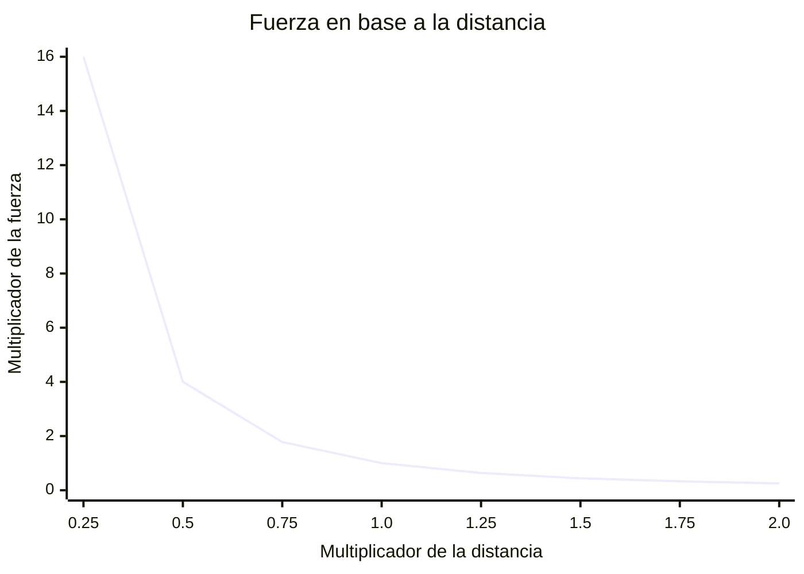

# LEY DE COULOMB

> [!seealso]- MIRA TAMBÉN
> - [Carga eléctrica](electric_charge.md)
> - [Principio de superposición](superposition_principle.md)
> - [Campo eléctrico](electric_field.md)

> [!important] CONCEPTOS IMPORTANTES
> - La fuerza eléctrica se mide en **newtons** ($N$), no en culombios.
> - La distancia debe expresarse en metros.
> - Las cargas deben expresarse en **culombios** ($C$).
> - El valor de $k$ indicado en los ejemplos corresponde al vacío; en otros medios puede cambiar.
> - Las dos cargas experimentan fuerzas de igual magnitud y sentidos contrarios.
> - La ley se aplica directamente a cargas puntuales en reposo.

## DEFINICIÓN

La **ley de Coulomb** describe la fuerza eléctrica que ejercen entre sí dos cargas eléctricas en reposo.

- **Mismo signo:** las cargas se repelen.
- **Distinto signo:** las cargas se atraen.
- La fuerza aumenta cuanto mayores son las cargas.
- La fuerza disminuye cuanto mayor es la distancia entre ellas.

> [!abstract] FÓRMULA  
> 
> $$F = k \frac{|q_1q_2|}{r^2}$$
> 
> - $F$: magnitud de la fuerza eléctrica (N).
> - $k$: constante de Coulomb ($\mathrm{N \cdot m^2 / C^2}$).
> - $q_1, q_2$: cargas eléctricas (C).
> - $r$: distancia entre las cargas (m).

En el vacío:

$$k \approx 8.99 \times 10^9\ \mathrm{N \cdot m^2 / C^2}$$

La fórmula calcula la **magnitud** de la fuerza ($F$). Para determinar su sentido, debemos observar los signos de las cargas.

%%

```text
 Atracción  |  Repulsión
(+)-> <-(-) | <-(+) (+)->
            | <-(-) (-)->
```

%%


## PROPIEDADES

### PROPORCIONALIDAD DE LAS CARGAS

La fuerza es directamente proporcional al producto de las magnitudes de las cargas.

$$F \propto |q_1q_2|$$

- Duplicar una carga: fuerza $\times 2$.
- Triplicar una carga: fuerza $\times 3$.
- Duplicar ambas cargas: fuerza $\times 4$.

### PROPORCIONALIDAD DE LA DISTANCIA

La fuerza es inversamente proporcional al cuadrado de la distancia.

$$F \propto \frac{1}{r^2}$$

- Duplicar la distancia: fuerza $\div 4$.
- Triplicar la distancia: fuerza $\div 9$.
- Reducir la distancia a la mitad: fuerza $\times 4$.

%%

```text
 Mayor cercanía
  mayor fuerza
   (+)=><=(-)

 Menor cercanía
  menor fuerza
(+)->      <-(-)
```

%%


%%

```text
 4.00 | #.
 3.75 | # .
 3.50 | # .
 3.25 | #  .
 3.00 | #  .
 3.75 | #   .
 3.50 | #   .
 3.25 | #    .
 2.00 | #    .
 1.75 | #     #.
 1.50 | #     #  .
 1.25 | #     #    .
 1.00 | #     #     #...
 0.75 | #     #     #   ..#..
 0.50 | #     #     #     #  ...#..
 0.25 | #     #     #     #     #  ...#.....#
      +-----------------------------------------
        0.50  0.75  1.00  1.25  1.50  1.75  2.00
```

%%



## DIRECCIÓN Y SENTIDO

La fuerza eléctrica es una **magnitud vectorial**.

- **Dirección:** la recta que une ambas cargas.
- **Sentido:** depende de si se atraen o se repelen.
- **Magnitud:** se calcula mediante la ley de Coulomb.

Las fuerzas que ejercen las dos cargas entre sí tienen igual magnitud y sentidos opuestos:

$$\vec{F}_{12} = -\vec{F}_{21}$$

## EJEMPLOS

> [!example] EJEMPLO 1 - CALCULAR LA FUERZA  
> Dos cargas $q_1 = +2, \mu \mathrm{C}$ y $q_2 = -3, \mu \mathrm{C}$ están separadas $0.5, \mathrm{m}$.
> 
> Convertimos las cargas:
> 
> $$q_1 = 2 \times 10^{-6}\ \mathrm{C}$$
> 
> $$q_2 = -3 \times 10^{-6}\ \mathrm{C}$$
> 
> Aplicamos la fórmula:
> 
> $$F = 8.99 \times 10^9 \frac{|(2 \times 10^{-6})(-3 \times 10^{-6})|}{0.5^2}$$
> 
> $$F \approx 0.216\ \mathrm{N}$$
> 
> **Resultado:** fuerza de atracción de aproximadamente $0.216, \mathrm{N}$.

> [!example] EJEMPLO 2 - CAMBIO DE DISTANCIA  
> Dos cargas se repelen con una fuerza de $20, \mathrm{N}$. ¿Qué ocurre si duplicamos la distancia?
> 
> $$F_{\text{nueva}} = \frac{F_{\text{inicial}}}{2^2}$$
> 
> $$F_{\text{nueva}} = \frac{20}{4} = 5\ \mathrm{N}$$
> 
> **Resultado:** la fuerza disminuye a $5,\mathrm{N}$.
